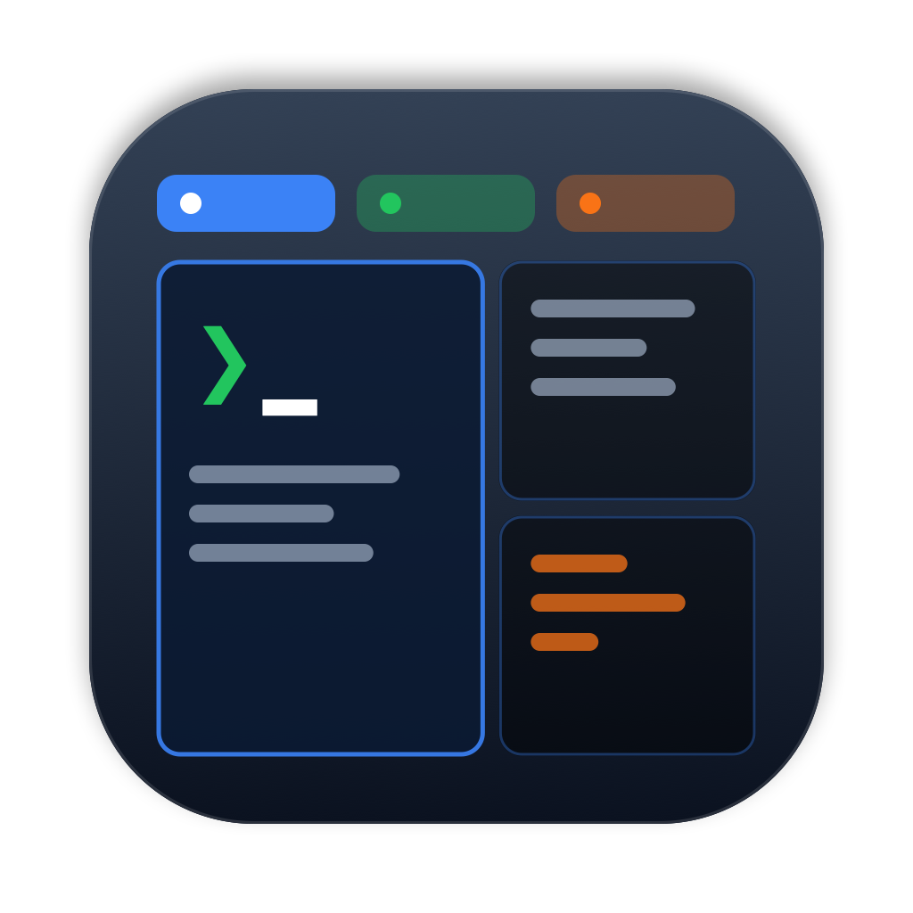
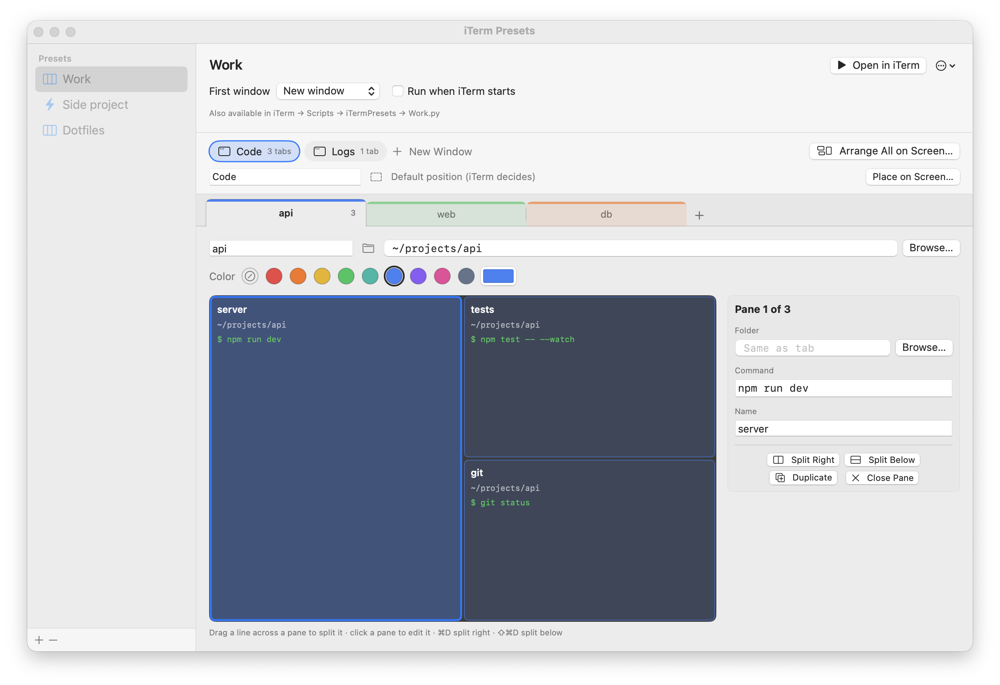
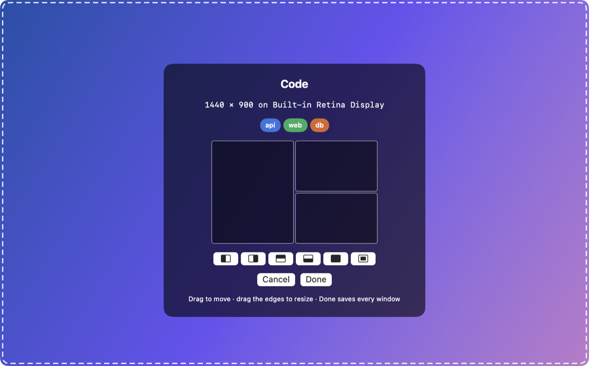

<p align="center">
  
</p>

<h1 align="center">iTerm Presets</h1>

<p align="center">
  Restore your whole iTerm2 setup in one click — windows, tabs, colors, split panes and startup commands.
</p>

<p align="center">
  <a href="https://github.com/sr3d/iTermPresets/releases/latest/download/iTermPresets.dmg"><b>⬇ Download for macOS</b></a>
  &nbsp;·&nbsp; macOS 13+ · Apple silicon &amp; Intel
  &nbsp;·&nbsp; <a href="https://github.com/sr3d/iTermPresets/releases">All releases</a>
</p>

<p align="center">
  <picture>
    <source media="(prefers-color-scheme: dark)" srcset="docs/screenshots/editor-dark.png">
    
  </picture>
</p>

A small macOS app for defining iTerm2 "presets": one or more windows, each placed where you
want it on screen and holding a set of tabs. Each tab has a title, tab color, working directory,
split panes and a startup command per pane. Open a whole preset in one
click, for example after a reboot.

Opening a preset **only adds** windows, tabs and splits. It never closes, quits or rearranges
anything already open in iTerm.

### Highlights

- **Draw your splits.** Drag a line across a pane to split it, click a pane to set its folder and command.
- **Colored tabs.** Pick a tab color from the palette, or any color.
- **Folder autocomplete.** Suggestions appear as you type, Tab completes like a shell, or Browse….
- **Multiple windows, placed exactly.** Drag a ghost window to where each iTerm window should open.
- **Lives in iTerm.** Presets show up under iTerm → Scripts, and can run automatically when iTerm starts.

## Download

[Download the latest DMG](https://github.com/sr3d/iTermPresets/releases/latest/download/iTermPresets.dmg)
(or pick a version from [Releases](https://github.com/sr3d/iTermPresets/releases)), open it and drag the app into
Applications. The app is ad-hoc signed, not notarized, so the first time you open it macOS will
refuse. Right-click the app and choose **Open**, or run:

```sh
xattr -dr com.apple.quarantine /Applications/iTermPresets.app
```

## Build

```sh
./build-app.sh            # -> build/iTermPresets.app
./build-app.sh --install  # also copies it into /Applications
```

You only need the Xcode Command Line Tools. Xcode itself is not required.

To package a disk image, run `./make-dmg.sh` after building, which writes
`dist/iTermPresets-<version>.dmg`. Both scripts take `VERSION=1.2.0`, and `UNIVERSAL=1` makes
`build-app.sh` build for both Apple silicon and Intel (that needs full Xcode).

### Releases

GitHub Actions (`.github/workflows/release.yml`) builds a universal DMG on every push to `main`
and on every pull request, and attaches it to the run. To publish a release, push a version tag:

```sh
git tag v1.2.0 && git push origin v1.2.0
```

The workflow creates the GitHub release `v1.2.0` with the DMG attached.

The app icon is drawn in code. To change it, edit `Icon/make-icon.swift` and run
`swift Icon/make-icon.swift`, which regenerates `Icon/AppIcon.icns`.

## Windows and placement

<p align="center">
  
</p>

- A preset can open several iTerm windows. The **window bar** above the tabs switches between
  them. **New Window** adds one, and right-clicking a window lets you duplicate, reorder or delete it.
- **Place on Screen…** shows a translucent *ghost window*. Drag it to where the real window
  should open and resize it from its edges, then click **Done** (Return) to save or **Cancel** (Esc).
  The snap buttons fit it to the left/right/top/bottom half of the screen, fill the screen, or
  center it.
- **Arrange All on Screen…** shows a ghost for every window at once, so you can lay them out
  together. Done saves all of them.
- **Reset** forgets the saved position and lets iTerm decide.
- **First window → Current window** puts the first window's tabs into your current iTerm window.
  That window is never moved or resized, so it has no placement.

Positions are absolute screen coordinates. If a display is unplugged, a window may open off
screen. iTerm can also round a window's size to fit whole character cells.

## Designing a tab

- **Tabs** sit in a strip at the top. Click a tab to edit it, `+` adds one, and right-clicking a tab
  lets you duplicate, move or delete it.
- **Color**: pick a swatch, or use the color well for a custom color.
- **Splits**: the tab is drawn as a big canvas. **Drag a line across a pane** to split it. A mostly
  vertical stroke puts the new pane on the right, a horizontal one puts it below. You can also
  hover a pane for split, duplicate and close buttons, or use iTerm's own shortcuts:
  ⌘D split right, ⇧⌘D split below, ⌥⌘D duplicate (same folder and command), ⌘⌫ close.
- **Click a pane** to set its folder, startup command and name in the side panel.
- **Folder fields suggest as you type.** Matching folders appear in a list below the field:
  ↑/↓ to move, **Return** or click to set the folder (the list closes), Esc to close the list.
  **Tab** completes like a shell: it fills in the folder, adds `/` and lists the subfolders,
  so you can drill down quickly.
  Or click **Browse…** to pick a folder in the standard folder picker.

Each split halves the pane, just like iTerm.

## How it works

- Presets are saved to `~/Library/Application Support/iTermPresets/presets.json`.
- Each preset is also written, kept in sync automatically, as an iTerm2 Python API script at
  `~/Library/Application Support/iTerm2/Scripts/iTermPresets/<name>.py`. It shows up in
  iTerm under **Scripts → iTermPresets**, so you can run it even without this app.
- **Open in iTerm** (⌘R) asks iTerm to run that script, using AppleScript's `launch API script named`.
- **Run when iTerm starts** copies the script into `Scripts/AutoLaunch/`, so iTerm opens the
  preset every time it launches. If you also use iTerm's own window restoration, you may get
  duplicate windows. Enable only one of the two.
- The generated script is plain Python with the preset embedded as JSON. You can export it or
  copy it and edit it by hand.

The app only deletes scripts that it generated itself (marked with `# iTermPresets-id:`).

## First run

- iTerm → Settings → General → Magic → **Enable Python API** must be on.
- The first time a Python API script runs, iTerm offers to download its Python runtime. Accept.
- macOS asks once whether iTerm Presets may control iTerm (Automation permission).

## Zoom

View → Zoom In (⌘=), Zoom Out (⌘-), Actual Size (⌘0). The whole UI scales and reflows,
and the zoom level is remembered between launches.
